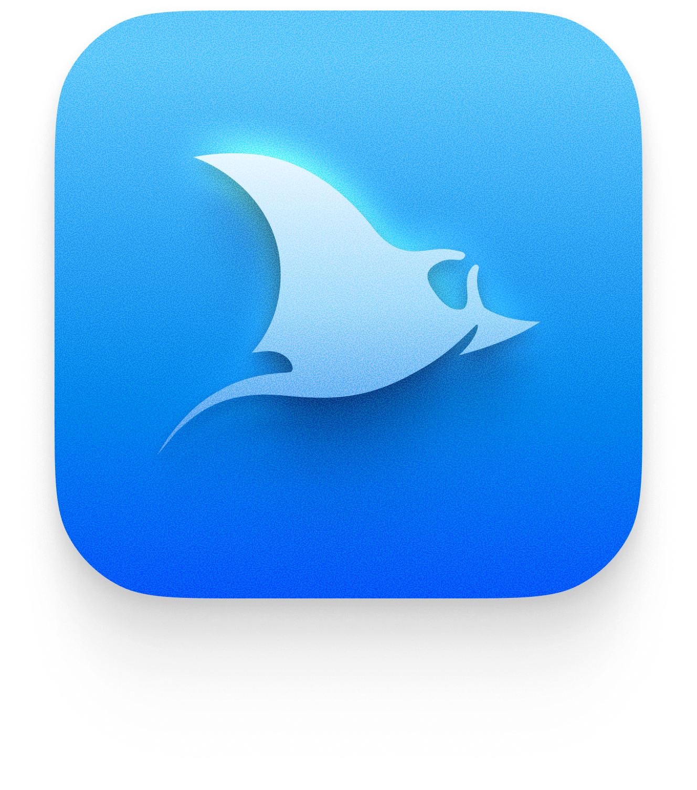

<div align="center">
  <picture>
    
  </picture>
</div>

<div align="center">

[](https://nextjs.org)
[](LICENSE)
[](https://www.typescriptlang.org)
[](https://github.com/afar1/fieldtheory-cli)

**Runs on macOS · Linux · Windows**

</div>

**Zegion** is a local-first browser for your X (Twitter) bookmarks. It renders bookmarks in a fluid, keyboard-driven interface with Media and Cards layouts, folder/category/author/domain filtering, full-text search with tag prefixes, a spring-animated lightbox, and dark mode — all running entirely on your machine.

Bookmarks are synced and classified through the locally installed [fieldtheory-cli](https://github.com/afar1/fieldtheory-cli). Classification uses Field Theory's authenticated Codex or Claude CLI and commits category/domain results directly to Field Theory's local database.

---

## 📑 Table of Contents

- [Features](#-features)
- [Requirements](#-requirements)
- [Quick Start](#-quick-start)
- [Commands](#-commands)
- [View Modes](#-view-modes)
- [Spatial Prototype](#-spatial-prototype)
- [Agent Continuity Pack](#-agent-continuity-pack)
- [Remote Access](#-remote-access)
- [Classification](#-classification)
- [Project Structure](#-project-structure)
- [State Preservation](#-state-preservation)
- [Troubleshooting](#-troubleshooting)
- [Built With](#-built-with)
- [License](#-license)

---

## 🛠️ Features

- **Media view** — image-first masonry grid for fast visual scanning
- **Cards view** — compact cards with tweet text, author, engagement counts, and timeline metadata
- **Lightbox** — full-size preview with smooth spring animation, keyboard navigation (Esc), and backdrop blur
- **Folder filtering** — browse by X bookmark folders (synced via X internal GraphQL)
- **Category & domain filtering** — filter by fieldtheory classification or linked external domains
- **Author facet** — filter by tweet author with count badges
- **Full-text search** — search across tweet text, authors, and handles with `@author`, `#category`, and `domain:` tag prefixes
- **Instant tag results** — inline author, category, and domain suggestions as you type
- **Sort picker** — Most recent, Oldest first, Most liked with icon-based dial
- **Dark mode** — persistent theme toggle with smooth transition
- **Keyboard shortcuts** — `⌘K` / `Ctrl+K` to open search, `Esc` to close lightbox
- **Sidebar drawer** — overlay panel with collapsible sections for all filter dimensions
- **State persistence** — folder, view, sort, search, facet, sidebar, and section collapses survive reload via `localStorage`
- **Responsive** — adapts to mobile and narrow viewports
- **Low-spec friendly** — smaller DOM pool and render buffer on devices with ≤4 GB RAM or ≤4 cores
- **Token-aware sync** — multi-browser cookie config (auto-detect Firefox/Edge/Chrome/Brave, or manual)
- **Re-indexing** — rebuild the local bookmark index from JSONL without re-syncing from X

---

## 📋 Requirements

- Windows, macOS, or Linux
- Node.js 22.5+ (Firefox cookie access on Windows uses `node:sqlite`)
- A browser logged into `https://x.com` (for cookie extraction)

---

## 🚦 Quick Start

```bash
git clone <repo-url> kairos
cd kairos
npm ci
```

The app uses the Field Theory dependency installed in this checkout; a global CLI installation is not required.

### 1. Configure sync authentication

Start the app, open **Sync settings** in the main menu, and choose Firefox auto-detection or Manual. Firefox must be logged into `x.com` on this computer. Manual mode accepts raw cookie values or `ct0=...` and `auth_token=...` inputs.

By default, settings are saved at `%USERPROFILE%\\.ft-bookmarks\\cookies-config.json`, a stable path that does not move when the database is created. On Windows, manual credentials are protected with the current user's DPAPI and are not portable to another account or computer. Each cloned machine needs its own Firefox session or its own manually entered credentials.

### 2. Start the viewer

```bash
npm run dev
```

Open **http://localhost:3001** in your browser.

---

## 📟 Commands

| Command | Description |
|---------|-------------|
| `npm run dev` | Start the Next.js dev server on port 3001 |
| `npm run build` | Production build |
| `npm start` | Start the production server on port 3001 |
| `npm test` | Run unit, architecture-freeze, and workflow tests |
| `npm run lint` | Run TypeScript checks |
| `node node_modules/fieldtheory/bin/ft.mjs sync --browser firefox` | Optional direct CLI sync diagnostic |

---

## 🎨 View Modes

### Media

Image-first masonry grid. Best for fast visual scanning. Click any card to open the lightbox with a smooth spring animation, backdrop blur, and info overlay.

### Cards

Compact metadata-rich cards showing image thumbnail (when available), author, handle, tweet text, engagement counts, and timeline dates (Posted / Saved / Synced).

---

## 🔬 Spatial Prototype

A research prototype at **`/spatial`** explores a canvas-style reading model: infinite zoom, compositor-only fluid zoom (magnifier), continuous camera motion, a single post-gesture settle, image LOD buckets, a minimap, and live motion tuning. It is **not** a shipped view mode. To try it:

```bash
npm run dev
# open http://localhost:3001/spatial
```

- Scroll / trackpad — pan · Ctrl+Scroll — zoom
- `−` / `+` — cursor-anchored step zoom · `Fit` — frame the whole world · `1:1` · `Reset`
- Click the minimap to jump
- `?wz=1` — one world-container transform instead of per-card writes
- `?zinstant=1` — disable continuous fluid zoom (A/B baseline)
- `?profile` / `Shift+P` — Kairos profiler
- `?probe` — expose `window.__spatialProbe.engine` for external verification scripts

See `docs/ARCHITECTURE.md`, `docs/DECISIONS.md` (D-01…D-06), and `.agent/` for the engine's invariants and known tradeoffs.

---

## 📚 Agent Continuity Pack

Layered docs for agents and maintainers (see `README` structure note in `AGENTS.md`):

| File | Contents |
|---|---|
| `AGENTS.md` | Agent behavior, repo rules, commands |
| `docs/PROJECT_STATE.md` | Why/what/who; implemented vs not; subsystems |
| `docs/ARCHITECTURE.md` | Component-level architecture |
| `docs/DECISIONS.md` | ADR-style decision log (D-01…D-17) |
| `docs/SYSTEM_MAP.md` | System graph + data flows |
| `docs/DOMAIN_MODEL.md` | Entities & relationships |
| `docs/INTEGRATIONS.md` | X / Field Theory / Codex |
| `docs/SECURITY_MODEL.md` | Threat model & controls |
| `docs/UX_SPEC.md` | UX principles & interactions |
| `docs/HISTORY.md` | Architectural evolution |
| `.agent/CURRENT_STATE.md` | Live project snapshot |
| `.agent/ACTIVE_TASK.md` | Current task status |
| `.agent/KNOWN_ISSUES.md` | Issue registry (ISSUE-001…) |
| `.agent/OPEN_QUESTIONS.md` | Unresolved questions (Q-001…) |
| `.agent/HANDOFF.md` | Agent handoff |
| `CONVERSATION_KNOWLEDGE.md` | Provenance-tracked knowledge (K-001…) |

**Bootstrap order for agents:** AGENTS.md → CURRENT_STATE.md → HANDOFF.md → PROJECT_STATE.md → SYSTEM_MAP.md → relevant ARCHITECTURE/DECISIONS sections → CONVERSATION_KNOWLEDGE.md → KNOWN_ISSUES.md → OPEN_QUESTIONS.md → source.

---

## 🌐 Remote Access

Your dev server listens on **3001** (`npm run dev`). To check it from another laptop, use a tunnel (all free):

**Cloudflare Tunnel (no account):**
```powershell
winget install --id Cloudflare.cloudflared
cloudflared tunnel --url http://localhost:3001
```

**ngrok:**
```powershell
winget install --id ngrok.ngrok
ngrok config add-authtoken <YOUR_TOKEN>
ngrok http 3001
```

**Tailscale (constant address, best for repeat use):**
```powershell
winget install --id Tailscale.Tailscale
tailscale up   # add both machines to the same tailnet
# other laptop: http://<your-tailscale-ip>:3001
```

**Notes:**
- Keep `npm run dev` running while testing.
- In dev, Next.js may block cross-origin dev resources for the tunnel host — add it to `allowedDevOrigins` in `next.config.ts` (dev only).
- In production, the API is guarded: for non-localhost callers set `X_API_KEY` and send it as the `x-api-key` header (see `SECURITY_MODEL.md`).
- LAN-only alternative: `npx next dev --port 3001 -H 0.0.0.0`, then use `http://<your-LAN-IP>:3001` on the same Wi-Fi.

---

## 🧠 Classification

Use **Classify** from the main menu to run Field Theory's native `ft classify` command in the background. It classifies categories and domains using the Field Theory engine preference (Codex or Claude) and commits completed batches directly to its local database; interrupted or failed runs can therefore leave earlier batches committed. The viewer export is refreshed by Field Theory after classification. On Windows, the installed Field Theory Codex launcher patch described in `AGENTS.md` must be present. Optionally set `FT_CLASSIFY_ENGINE=codex` or `FT_CLASSIFY_ENGINE=claude` to select an engine for app-launched runs; otherwise Field Theory uses its saved preference/normal engine resolution. **Classification history** retains older staged-provider records as read-only history. The experimental provider service and frozen evaluation artifacts remain in `lib/classify/` but are no longer used by the app's Classify action.

After a manual sync setup saved in an older checkout, restart the app once to migrate its settings to the stable per-user path. To manually inspect exported categories:

```powershell
node -e "const d=require('./data/output/bookmarks-data.json'); const cats={}; d.bookmarks.forEach(b=>{const c=b.category||'unclassified'; cats[c]=(cats[c]||0)+1}); console.log('Categories:', cats)"
```

---

## 🏗️ Project Structure

```
zeleon/
├── app/                        # Next.js App Router pages and API routes
│   ├── api/                    # API endpoints (bookmarks, sync, reindex, status, cookies)
│   ├── globals.css             # All component styling
│   ├── layout.tsx              # Root layout with fonts and DialRoot
│   └── page.tsx                # Entry point
├── components/                 # React components
│   ├── BookmarksViewer.tsx     # Main viewer (toolbar, feed, search, lightbox)
│   └── ui/                    # Primitive UI components (dialog, sort-picker, drawer, etc.)
├── hooks/
│   └── useBookmarkViewer.ts    # Core viewer state, grid layout, lightbox animation
├── lib/
│   ├── api-auth.ts             # API key / localhost guard
│   ├── client-api.ts           # Fetch wrapper with API key header
│   ├── native-config.ts        # Runtime path resolution
│   ├── cookie-config.ts        # Multi-browser cookie config
│   ├── server-jobs.ts          # Sync / reindex orchestration
│   ├── export-bookmarks.js     # Bookmark JSONL → bookmarks-data.json
│   ├── sync-folders.js         # X folder GraphQL fetcher
│   └── config.js               # Shared path/env resolution for scripts
├── data/                       # Generated data (gitignored)
│   └── output/                 # bookmarks-data.json, folders-data.json
├── assets/                     # Static assets
│   └── Logo/                   # Zegion logo files
├── .env.example                # Environment variable template
├── next.config.ts              # Next.js configuration
├── package.json
└── README.md
```

---

## 💾 State Preservation

The following state is saved to `localStorage` under key `kairos_state` and restored on reload:

- Dark mode toggle
- Active folder
- Active view (Media / Cards)
- Sort order
- Search text
- Active facet type and value
- Sidebar open/closed
- Sidebar section collapsed/expanded states

---

## 🔧 Troubleshooting

### `Missing X_CT0` or `Missing X_AUTH_TOKEN`
Open **Sync settings** and choose Firefox Auto or Manual. Manual accepts raw cookie values and values prefixed with `ct0=` / `auth_token=`. Re-enter expired cookies; the app never returns saved values through the API.

### `403` / `401` during folder sync
Cookies are stale, swapped, or X logged you out. In Auto/Firefox mode, sign into `x.com` in Firefox on this machine. In Manual mode, re-copy both values from browser DevTools.

### `Found 0 folders`
Either your account doesn't use bookmark folders, or X's GraphQL response shape changed.

### `Bookmarks JSONL not found`
Set `FT_DATA_DIR` or `X_BOOKMARKS_JSONL` in your local `.env` pointing to the Field Theory bookmarks location. `FT_DATA_DIR` also anchors the settings file; it must be the same on subsequent launches.

### Firefox auto sync cannot read cookies
Sign into X in Firefox and retry. Field Theory owns Firefox profile discovery; if its cookie database is locked or inaccessible, close Firefox and retry. Zegion does not silently switch auth modes.

### `Unexpected token... Internal Server...` on Sync / Re-index
The server returned an HTML error page instead of JSON, usually because the job timed out or the API endpoint crashed. Check the terminal output for the full stack trace. Make sure the Field Theory CLI is installed and the scripts in `lib/` have executable permissions.

---

## 🏗️ Built With

Zegion is a **local-first** Next.js application. No cloud service, account, or API key is required to browse your bookmarks.

| Layer | Technology |
|-------|------------|
| **Framework** | [Next.js 16](https://nextjs.org) (App Router, Turbopack) |
| **Language** | [TypeScript](https://www.typescriptlang.org) / JavaScript |
| **Runtime** | [Node.js](https://nodejs.org) |
| **Animation** | [Motion](https://motion.dev) (Framer Motion) |
| **UI primitives** | [Base UI](https://base-ui.com) (Radix), [Dial Kit](https://github.com/joshpuckett/dialkit) |
| **Icons** | [Hugeicons](https://hugeicons.com), [Lucide](https://lucide.dev) |
| **Bookmark sync** | [fieldtheory-cli](https://github.com/afar1/fieldtheory-cli) |
| **Styling** | [Tailwind CSS 4](https://tailwindcss.com) + CSS custom properties |
| **State** | React hooks + `localStorage` persistence |

---

## 🛡️ License

Released under the [MIT License](LICENSE).
